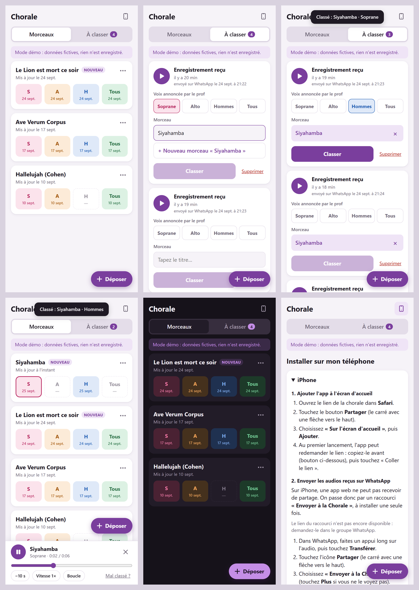

# Chorale – webapp de répétition

Une liste de morceaux avec 4 boutons chacun (**S · A · H · Tous**), et un onglet **À classer** que tous les choristes peuvent remplir avec les audios envoyés par le prof sur WhatsApp.

- Pas de compte ni de mot de passe : on entre avec le **lien secret** de la chorale (`https://<projet>.web.app/?cle=<clé>`), et le téléphone s'en souvient.
- Tout le monde peut déposer et classer. Le premier qui classe gagne, et **« Mal classé ? »** renvoie l'audio dans « À classer ».
- Pas d'historique : un nouvel audio remplace l'ancien pour la même voix du même morceau.
- Un même audio déposé deux fois n'est gardé qu'une fois (empreinte SHA-256).



Sommaire : [1. Essayer](#1-essayer-tout-de-suite-mode-démo) · [2. Mise en ligne](#2-mise-en-ligne-sur-firebase-environ-20-min-une-seule-fois) · [3. Lien d'accès](#3-créer-le-lien-daccès-de-la-chorale) · [4. Téléphones](#4-installer-lapp-sur-les-téléphones) · [5. Raccourci iPhone](#5-raccourci-iphone--envoyer-à-la-chorale-) · [6. Utilisation](#6-utilisation) · [7. Tests](#7-tests) · [8. Émulateurs](#8-développer-avec-les-émulateurs-firebase) · [9. Fichiers](#9-fichiers) · [10. Choix techniques](#10-choix-techniques)

---

## 1. Essayer tout de suite (mode démo)

L'app est branchée sur le projet Firebase **onchantequoi** (`src/app/config.ts`, `.firebaserc`).

**En ligne, en attendant le forfait Blaze** : https://onchantequoi.web.app tourne en mode démo pour tout le monde (`demoOnly = true` dans `src/app/config.ts`). C'est gratuit (Hosting seul) et ça permet d'essayer l'app sur de vrais téléphones : installation, lecture, partage depuis WhatsApp sur Android. Rien n'est enregistré, chaque téléphone a ses propres données fictives. Pour republier seulement le site : `npm run deploy:site`.

En local, ajoutez `?demo` à l'adresse pour les données fictives :

```bash
npm install
npm start
# puis ouvrir http://localhost:4200/?demo
```

Il faut **Node 22**. Grâce au champ `volta` du `package.json`, Volta le choisit tout seul dans ce dossier. Sans Volta, faites `nvm use 22`.
Une fois en ligne, on peut toujours montrer la démo avec `https://<projet>.web.app/?demo`.

---

## 2. Mise en ligne sur Firebase (environ 20 min, une seule fois)

1. **Créer le projet** sur https://console.firebase.google.com, par exemple « chorale-xxx ».
   Créez-le avec un **compte Google personnel**, pas avec un compte d'entreprise (Google Workspace). Une organisation peut interdire les fonctions publiques, et le raccourci iPhone recevrait alors une erreur 403.
2. **Passer au forfait Blaze** (carte bancaire). C'est obligatoire pour le stockage des audios et pour la fonction du raccourci iPhone.
   → Dans *Google Cloud Console > Facturation > Budgets et alertes*, créez un budget de **1 €** avec une alerte e-mail.
   → Coût attendu : Firestore et la fonction restent dans le gratuit. Pour Storage, le quota gratuit (5 Go) ne vaut que pour les régions américaines (`us-central1`, `us-east1`, `us-west1`) : en `europe-west1`, comptez quelques centimes par mois (stockage et téléchargements). Choisissez `us-central1` à l'étape 5 si vous préférez rester à 0 €.
3. **Authentication** > Commencer > Méthode de connexion : activez **Anonyme**.
4. **Firestore Database** > Créer une base : mode production, région `europe-west1` (ou `eur3`).
5. **Storage** > Commencer : même région (ou `us-central1`, voir le coût ci-dessus).
6. **Application Web** : déjà faite pour onchantequoi (sa configuration est dans `src/app/config.ts`). Pour un autre projet : *Paramètres du projet* > *Vos applications* > application Web (`</>`), puis copiez la configuration dans `src/app/config.ts`.
7. **ID du projet** : déjà `onchantequoi` dans `.firebaserc`.
8. Dans `src/app/config.ts`, passez `demoOnly` à `false`, puis déployez :
   ```bash
   npx firebase login                 # une seule fois (déjà fait sur ce PC)
   npm --prefix functions install     # dépendances de la fonction « depot »
   npm run deploy                     # = ng build + firebase deploy
   ```
   La CLI Firebase fait partie du projet (`firebase-tools` dans les devDependencies) : pas besoin de l'installer globalement.
   `firebase deploy` publie l'app (Hosting), les règles Firestore et Storage, les index et la fonction `depot` (région europe-west1, Node 22).
   - Au premier déploiement de la fonction, la CLI active les API nécessaires (Cloud Functions, Cloud Build, Artifact Registry, Cloud Run…). Acceptez.
   - Si elle demande combien de jours garder les images de conteneur, répondez **1** : cela évite de petits frais de stockage.
   - Si la console le demande, **acceptez l'autorisation qui permet aux règles de Storage de lire Firestore** (sinon personne ne pourra écouter ni déposer).
   - Le tout premier déploiement de la fonction échoue parfois, le temps que les autorisations se propagent : relancez simplement `firebase deploy`.

Pour republier seulement l'app après une modification : `ng build && firebase deploy --only hosting`.

---

## 3. Créer le lien d'accès de la chorale

Dans **Firestore**, cliquez sur *Commencer une collection* :

- ID de la collection : `keys`
- ID du document : une clé secrète, par exemple `VMgkUrmfd6r0nNB4RdSrow` (au moins 10 caractères, uniquement des lettres, des chiffres, `-` ou `_`)
- champ : `note` (texte) = `lien de septembre 2026`, par exemple

Le lien à poster dans le groupe WhatsApp est ensuite :

```
https://<id-du-projet>.web.app/?cle=VMgkUrmfd6r0nNB4RdSrow
```

**Changer le lien** (s'il a fuité) : créez un nouveau document dans `keys`, supprimez l'ancien, et postez le nouveau lien. Les anciens accès sont coupés immédiatement (l'app redemande le lien). Pensez aussi à mettre à jour le raccourci iPhone.

---

## 4. Installer l'app sur les téléphones

Dans l'app, l'icône de téléphone en haut à droite ouvre la page **« Installer sur mon téléphone »**. Elle montre d'abord les explications pour l'appareil utilisé (Android, iPhone ou ordinateur).

- **Android** : dans Chrome, menu ⋮ > *Installer l'application* (ou le bouton « Installer l'app » de la page d'aide). Une fois l'app installée, on peut partager des audios depuis WhatsApp vers **Chorale**.
- **iPhone** : dans Safari, bouton Partager > *Sur l'écran d'accueil*. L'app installée ne partage pas la mémoire de Safari : au premier lancement, elle peut redemander le lien. Il suffit de le coller (bouton « Coller le lien »).
- **Ordinateur** : pas d'installation nécessaire. On peut glisser les audios n'importe où sur la page.

---

## 5. Raccourci iPhone « Envoyer à la Chorale »

Sur iPhone, une app web ne peut pas recevoir de partage. On passe donc par un raccourci de l'app **Raccourcis**, qui envoie les fichiers à la fonction `POST https://<projet>.web.app/api/depot?cle=<clé>`. Les audios arrivent alors dans « À classer ».

Apple empêche de fabriquer le fichier du raccourci : il faut le **créer une fois à la main**, puis le partager par un **lien iCloud** dans le groupe.

- Recette pas à pas, avec les libellés iOS vérifiés : **[docs/raccourci-iphone.md](docs/raccourci-iphone.md)**
- Résumé : action *Texte* (l'adresse d'envoi) → *Dans la feuille de partage* (types Fichiers et Supports) → *Répéter chaque élément* → *Obtenir le contenu de l'URL* (POST, en-tête `X-Nom` = nom de l'élément, *Demander le corps* : Fichier) → *Afficher la notification*.
- La page d'aide de l'app affiche l'adresse d'envoi déjà remplie avec la clé, et un bouton pour la copier.
- Une fois le lien iCloud obtenu, collez-le dans `shortcutUrl` (`src/app/config.ts`) puis republiez l'app. La page d'aide affichera alors un bouton « Installer le raccourci ».

Tester la fonction à la main (depuis un ordinateur) :

```bash
curl -X POST --data-binary "@WhatsApp Audio.mp4" -H "Content-Type: application/octet-stream" -H "X-Nom: test.mp4" "https://<projet>.web.app/api/depot?cle=<clé>"
```

(Sans l'en-tête `Content-Type`, curl annonce un formulaire, et un vrai fichier audio est refusé avant même d'arriver à la fonction.)

Réponses possibles, affichées telles quelles dans la notification du raccourci : « 1 audio envoyé dans « À classer » », « 1 déjà reçu », « Lien de la chorale invalide » (clé supprimée ou erronée), « … refusé (pas un audio ou trop gros) » (30 Mo maximum), « Erreur du serveur, réessayez dans un moment ».
La fonction traite 3 envois à la fois ; au-delà, elle demande de réessayer (erreur 429).

---

## 6. Utilisation

- **Déposer** : bouton en bas à droite, pour choisir un ou plusieurs audios.
  - *Android* : une fois l'app installée, on peut partir de WhatsApp. On sélectionne les audios, on touche **Partager**, puis **Chorale**.
  - *iPhone* : on utilise le raccourci « Envoyer à la Chorale » depuis WhatsApp. Sans raccourci, on enregistre l'audio dans *Fichiers*, puis on touche **Déposer**.
  - *Ordinateur* : on glisse les fichiers n'importe où sur la page.
- **À classer** : on écoute, on touche la voix annoncée par le prof, on choisit le morceau (ou on tape un nouveau titre), puis on touche **Classer**. Le morceau choisi est pré-rempli pour les audios suivants. La date d'envoi WhatsApp s'affiche quand le nom du fichier la contient.
- Si deux personnes déposent le même audio, il n'est gardé qu'une fois. Si deux personnes classent le même audio en même temps, c'est le premier qui compte.
- Un nouvel enregistrement **remplace** l'ancien pour la même voix du même morceau, et l'ancien fichier est supprimé.
- **Mal classé ?** : dans le lecteur, ce bouton renvoie l'audio dans « À classer ».
- Le lecteur propose aussi un retour de 10 s, une vitesse 1× / 0,85× / 0,7× (sans changer la hauteur des notes) et une boucle. Il se pilote depuis l'écran verrouillé.
- Le menu **⋯** d'un morceau permet de le renommer, ou de le supprimer s'il est vide.

---

## 7. Tests

| Commande | Ce qui est testé |
|---|---|
| `npm test` | l'app : utilitaires, mode démo, brouillons de classement, affichage (Vitest) |
| `npm run test:functions` | la logique pure de la fonction `depot` : lecture du corps et détection du format |
| `npm run test:rules` | les règles Firestore et Storage dans l'émulateur : non-membre refusé, clé supprimée donc accès coupé, `keys` illisible, etc. |
| `npm run test:depot` | la fonction `depot` de bout en bout dans les émulateurs : dépôt, doublon, clé invalide, fichier refusé, multipart |

Résultats au 25 septembre 2026 : 28 tests pour l'app, 13 pour la fonction, 34 pour les règles (vérifiés aussi contre des règles volontairement affaiblies) et 12 de bout en bout.

Les deux dernières commandes lancent les émulateurs Firebase. Elles demandent `firebase-tools` et **Java 21 ou plus** : le Java par défaut de ce PC est un Java 8, trop ancien. Celui d'Android Studio convient :

```powershell
# PowerShell
$env:JAVA_HOME = "C:\Program Files\Android\Android Studio\jbr"; $env:Path = "$env:JAVA_HOME\bin;$env:Path"
```

```bash
# Git Bash
export JAVA_HOME="/c/Program Files/Android/Android Studio/jbr"; export PATH="$JAVA_HOME/bin:$PATH"
```

Avant la première fois : `npm --prefix functions install` et `npm --prefix rules-tests install`. Au premier lancement, les émulateurs se téléchargent (quelques dizaines de Mo).
Pour savoir quelle ligne des règles a refusé une requête : `DEBUG_RULES=1 npm run test:rules`. Si Java affiche « Unable to establish loopback connection », ajoutez `JAVA_TOOL_OPTIONS=-Djdk.net.unixdomain.tmpdir=C:\Temp` (dossier existant, chemin court).

---

## 8. Développer avec les émulateurs Firebase

Pour essayer la vraie version (Auth, Firestore, Storage, fonction) sans toucher au projet en ligne :

```bash
npm run emulators         # terminal 1 (avec JAVA_HOME réglé, voir ci-dessus) ; console : http://localhost:4000
npm run emulators:seed    # terminal 2 : crée la clé « cle-de-test-chorale »
npm start                 # puis ouvrir http://localhost:4200/?emu&cle=cle-de-test-chorale
```

Le paramètre `?emu` (seulement sur `localhost`) branche l'app sur les émulateurs, avec le projet fictif `demo-chorale`.

---

## 9. Fichiers

| Fichier | Rôle |
|---|---|
| `src/app/config.ts` | configuration Firebase, nom de la chorale, lien du raccourci iPhone |
| `src/app/core/` | état de l'app (`chorale.store.ts`), accès Firebase (`firebase-backend.ts`) et démo (`demo-backend.ts`), lecteur, dépôt, installation |
| `src/app/features/` | pages Morceaux, À classer, Installer, et l'écran d'accueil (lien) |
| `src/app/shared/` | lecteur, feuilles modales, messages, zone de glisser-déposer |
| `public/sw.js`, `public/manifest.webmanifest` | installation sur le téléphone, hors-ligne, réception des partages WhatsApp (Android) |
| `ngsw-config.json` | ce que le service worker Angular garde en cache |
| `firestore.rules`, `storage.rules` | sécurité : accès uniquement avec une clé valide |
| `functions/` | fonction `depot` (raccourci iPhone, et plus tard relevé e-mail ou bot) |
| `rules-tests/` | tests des règles dans l'émulateur |
| `docs/raccourci-iphone.md` | recette du raccourci iPhone |
| `specs/` | brief, prototype d'origine (HTML/JS) et maquette |

---

## 10. Choix techniques

- **Angular 21**, comme les autres projets (emotions) : composants autonomes, signals, sans zone.js, pages chargées à la demande, tests Vitest. Le prototype sans framework de `specs/public/` a servi de référence fonctionnelle et visuelle, écran par écran.
- **Mode démo conservé** : le SDK Firebase n'est chargé que hors démo (fichier séparé, environ 170 ko compressés). L'app de départ pèse environ 80 ko compressés.
- **Service worker** : `public/sw.js` reçoit les partages Android (`POST /share`), puis délègue le reste au service worker Angular (hors-ligne, mises à jour). Quand une nouvelle version est prête, un bandeau propose de recharger.
- **Firestore en cache local** : la liste des morceaux s'affiche tout de suite, même sans réseau. Les audios, eux, demandent le réseau.
- **Lecture sur iPhone** : l'adresse de l'audio est demandée dès l'appui sur une voix, et le lecteur est « débloqué » dans le geste même (exigence d'iOS). Rien ne se joue avant qu'on touche une voix : la musique de l'utilisateur n'est pas coupée à l'ouverture de l'app.
- **Plusieurs personnes en même temps** : « Mal classé ? » ne retire l'audio que s'il occupe toujours la voix. Supprimer un audio ou un morceau vérifie qu'il n'a pas été classé ou complété entre-temps. Un audio qu'on a commencé à classer garde le morceau affiché, même si quelqu'un classe autre chose.
- **Réseau faible** : si le lien ne peut pas être vérifié, l'app propose « Réessayer » au lieu de dire que le lien est invalide. Les audios partagés depuis Android restent en attente sur le téléphone tant qu'ils ne sont pas envoyés.
- **Sécurité** : règles Firestore et Storage testées dans l'émulateur. L'en-tête `Referrer-Policy: strict-origin-when-cross-origin` garantit que le lien complet (qui contient la clé) n'est jamais transmis aux autres sites.

### À vérifier au premier essai

- Les messages vocaux WhatsApp (Opus/Ogg) se lisent sur Android et sur les iPhone récents, mais un iPhone ancien (iOS 17 ou moins) pourrait ne pas les lire. Si le cas se présente, on ajoutera une conversion automatique.
- Le raccourci iPhone : quelques libellés de l'app Raccourcis n'ont pas pu être vérifiés mot pour mot (signalés par ⚠️ dans la recette).
- Le partage Android depuis WhatsApp : testé en simulant l'envoi du partage dans Chromium, pas encore sur un vrai téléphone.

### Pistes pour la suite

- Relevé e-mail : une adresse Gmail dédiée et un Google Apps Script qui, toutes les 5 min, poste les pièces jointes sur `/api/depot`.
- Pré-cocher la voix en transcrivant le début de l'audio (le prof dit « sopranes », « altos »…).
- Un bot WhatsApp (Baileys) avec un numéro dédié.
- Le prénom de la personne qui a classé l'audio (stocké uniquement en local).
- Garder hors ligne les audios déjà écoutés.
